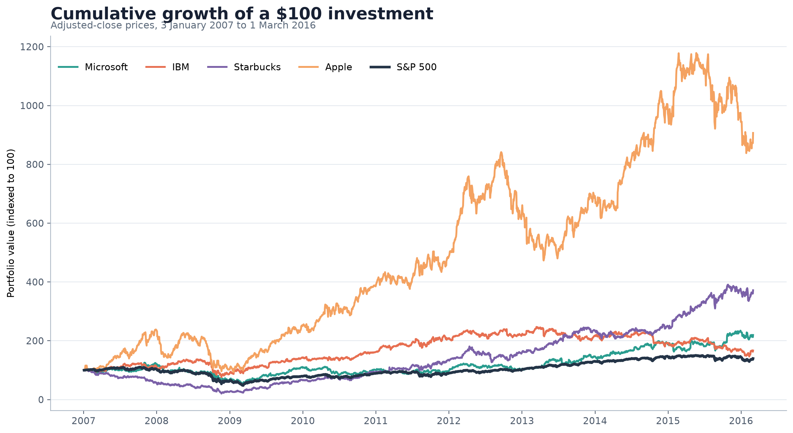
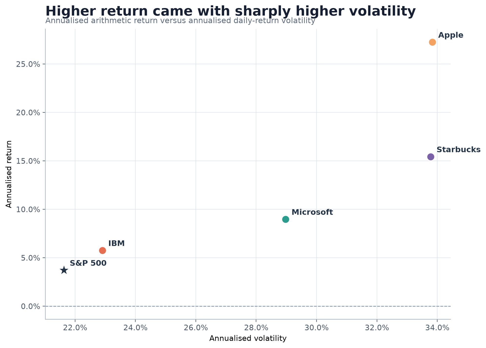
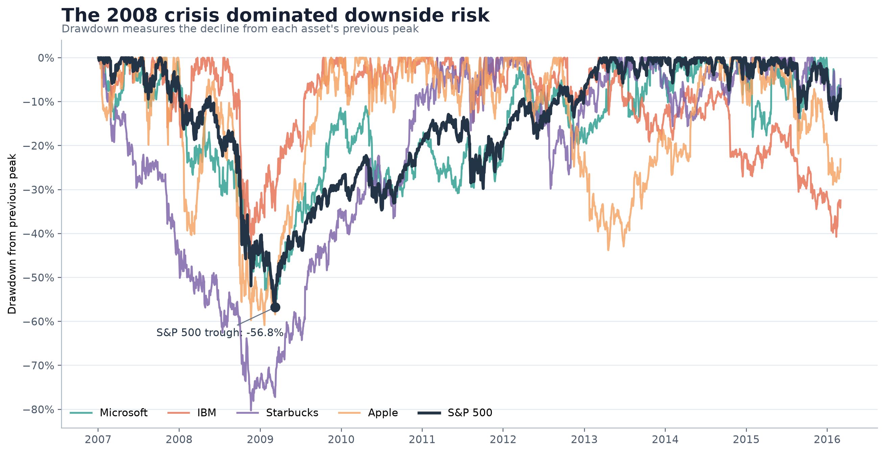

# Stock Market Risk and Return, 2007-2016

This project compares the performance and downside risk of four well-known
technology and consumer stocks with the S&P 500 over a period that includes the
2008 global financial crisis.

## Research question

How did Apple, IBM, Microsoft and Starbucks compare with the S&P 500 in terms of
cumulative growth, annualised return, volatility, risk-adjusted return and
maximum drawdown between January 2007 and March 2016?

## Dataset and permissions

The dataset is `stock_prices.csv`, a compact educational snapshot of historical
adjusted-close prices compiled from Yahoo Finance for the student's earlier
course project. It contains 2,306 daily observations from 3 January 2007 through
1 March 2016 for:

- Microsoft (`MSFT`)
- IBM (`IBM`)
- Starbucks (`SBUX`)
- Apple (`AAPL`)
- S&P 500 index (`GSPC`)

The file contains no passwords, API keys, personal information or private
datasets. It is included only for course and portfolio reproducibility. Market
data remain subject to the original provider's terms and should be checked
before reuse outside an educational context.

## Methods and tools

The analysis uses Python with pandas, NumPy and Matplotlib.

1. Prices are indexed to 100 at the start of the period to compare cumulative
   growth.
2. Daily percentage returns are calculated from consecutive adjusted-close
   prices.
3. Annualised return is calculated from the change in the price series over the
   full observation period.
4. Annualised volatility is the standard deviation of daily returns multiplied
   by the square root of 252 trading days.
5. The Sharpe ratio uses the same formula with an assumed risk-free rate of
   zero, so it is useful for relative comparison only.
6. Maximum drawdown is the largest percentage decline from a previous price
   peak.

## Key findings

| Asset | Total return | Annualised return | Annualised volatility | Sharpe ratio (Rf = 0) | Maximum drawdown |
|---|---:|---:|---:|---:|---:|
| Apple | 806.8% | 27.3% | 33.8% | 0.88 | -60.9% |
| Starbucks | 271.8% | 15.4% | 33.8% | 0.59 | -80.2% |
| Microsoft | 119.5% | 9.0% | 29.0% | 0.44 | -57.9% |
| IBM | 66.9% | 5.8% | 22.9% | 0.36 | -44.3% |
| S&P 500 | 39.7% | 3.7% | 21.6% | 0.28 | -56.8% |

Apple produced the strongest cumulative and risk-adjusted performance in the
sample. The S&P 500 offered the lowest volatility, while IBM experienced the
smallest maximum drawdown. Starbucks duplicated Apple's annualised volatility
but suffered a deeper drawdown of 80.2%, showing that similar volatility does
not always imply similar downside risk.

The 2008 crisis affected every series. The S&P 500 fell 56.8% from its previous
peak, whereas Starbucks recorded the deepest decline among the selected stocks.
Daily returns were more strongly correlated with the S&P 500 than with one
another, ranging from 0.615 for Apple to 0.714 for IBM.

### One limitation

The sample contains four prominent, established firms and is therefore exposed
to survivor and selection bias. It does not represent all listed companies,
model transaction costs or taxes, or establish that past performance predicts
future returns.

## Visualisations

### Cumulative growth



### Risk and return



### Drawdowns



## Run the analysis

Python 3.10 or later is recommended.

```bash
python -m venv .venv
source .venv/bin/activate
pip install -r requirements.txt
python analysis.py
```

On Windows, activate the environment with:

```powershell
.venv\Scripts\Activate.ps1
```

The script overwrites the generated tables in `outputs/` and figures in
`figures/`. It prints the main metrics and the daily-return correlation matrix
to the terminal.

## Project files

```text
data-science-project/
├── analysis.py
├── requirements.txt
├── stock_prices.csv
├── figures/
│   ├── 01_cumulative_growth.png
│   ├── 02_risk_return.png
│   └── 03_drawdowns.png
└── outputs/
    ├── daily_returns.csv
    └── summary_metrics.csv
```

This project is an educational analysis, not financial advice.
